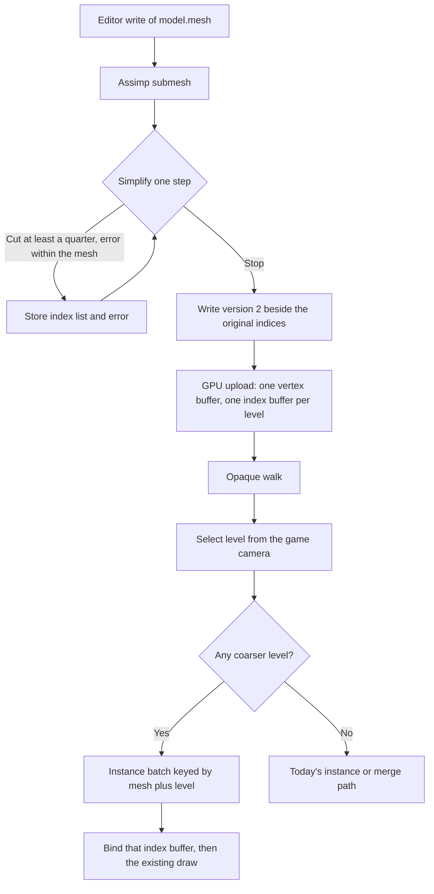
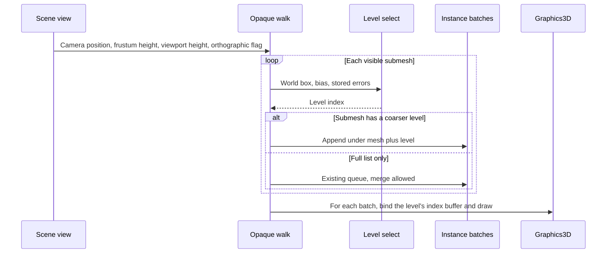

# Mesh LOD — Developer Guide

How to add simplified index levels and select one in the opaque walk. Assumes the `.mesh` sibling write, `SceneRenderPipeline`, and instanced mesh draws.

## Implementation Overview





Color and both shadow passes run this walk. Both call the selector with the game camera. The light matrix is only the shadow cull.

## Glossary

| Term | Implementation meaning |
|------|------------------------|
| Level 0 | The index list already stored on the submesh. Error 0. Not written a second time |
| Coarser level | An extra index list in the version-2 chunk. Indices address the original vertices |
| File error | Absolute mesh-space deviation stored for that list, forced to be at least 1.5× the previous list |
| World error | File error times the largest absolute axis scale of the entity world matrix |
| Allowed error | `distance * frustumHeightAtUnit * (1 / bias) / viewportHeight`. Orthographic distance is 1 |
| Frustum height | `2 / projection.M22`. Perspective: height of the frustum at distance 1. Orthographic: `2 * OrthographicSize` |
| Viewport height | Pixel height of the framebuffer being drawn, not the logical window size |
| Has levels | The mesh uploaded more than the original index buffer |

## Step-by-Step Requirements

### 1. Simplify while the sibling mesh is written

After Assimp fills a submesh, and before `RuntimeMeshWriter` finishes, run the simplifier on that submesh’s positions and indices. Positions are the first three floats of each vertex. The vertex stride is the existing 56-byte layout. Pass normals and UVs as attributes with weight 1 so the choice of which edge collapses respects them. The output indices still refer to the input vertices.

Each step targets half the current triangle count, with the border-lock and sparse flags. Keep the list only when the new index count is a positive multiple of three, every index is in range, and the count is at most 75% of the previous count. Accumulate error as the max of 1.5× the previous error and this step’s relative error, then multiply by `meshopt_simplifyScale` when storing. Stop at four triangles or fewer remaining, when a step fails the 75% cut, or when the accumulated relative error exceeds 1 (the mesh’s own size). Run the vertex-cache optimizer on each kept list. A thrown native call, or a missing library, logs once and writes the submesh with no extra lists.

### 2. Bump the file so old siblings still read

Write version 2. Accept version 1 in the reader as a mesh with no extra lists. A version-2 submesh whose level block cannot be parsed logs, drops that submesh’s extra lists, and keeps the base indices. Any other version fails the whole file, as the reader does today. Bump the importer stamp so the editor rewrites existing siblings. The player does not rewrite them.

### 3. Upload every index list once

`Mesh.Initialize` creates one vertex buffer and one index buffer per list, including level 0. Upload stays on the render thread. A list that fails to upload is dropped. Finer lists remain. Dispose releases every index buffer with the vertex array.

### 4. Select a level with no allocation

Call this from the opaque gather, once per submesh per pass, using the game camera even in a shadow pass. Square both sides of the glossary inequality so the box distance stays a squared length and the walk does not take a square root.

```
scale = largest absolute axis scale of the world matrix
if scale, viewport height, or frustum height is unusable: return 0
if the mesh has no world box: return 0
distanceSquared = 1 when the orthographic flag is set, otherwise the squared distance from the camera to the closest point of the world box
factor = frustumHeight * (1 / bias) / viewportHeight
limitSquared = distanceSquared * factor * factor
return the greatest level whose (fileError * scale)² is <= limitSquared
```

Level 0 has file error 0, so it always qualifies. A camera inside the box makes `distanceSquared` 0, so only level 0 qualifies. Bias is already sanitized to a positive finite value on the component.

### 5. Put the level on the batch key and skip merge

The instance batch key gains the level index. A mesh that has a coarser level never joins a merge group, even when the selector returns 0. Cubes and meshes with only level 0 keep today’s split between instancing and merging.

### 6. Bind the index buffer after the vertex array

Core profile stores the element buffer on the vertex array. After binding the mesh’s vertex array, bind the chosen level’s index buffer, then the existing indexed or instanced draw. Do this on every batch. A later batch of the same mesh at another level binds again. No new shader, no new vertex attribute.

### 7. Fill the view from the camera that already exists

`SceneView` carries viewport height, frustum height at one unit, and the orthographic flag. `CameraViews` and the editor viewport set them when they build the view. Runtime height is the window framebuffer height. Editor height is the viewport framebuffer height. A height of zero selects level 0 for the whole view.

### 8. Expose bias on the existing inspector

Add `LodBias` next to the other floats on the model renderer inspector. Default 1. The JSON component serializer already writes public properties. `Clone` copies the field.

## Why This Order

The file format has to exist before upload, and upload has to exist before the walk can bind a list. The selector is independent of both and is the test that locks the pixel rule. Merge is excluded only after the selector exists, so a mesh with no generated list is unaffected.
