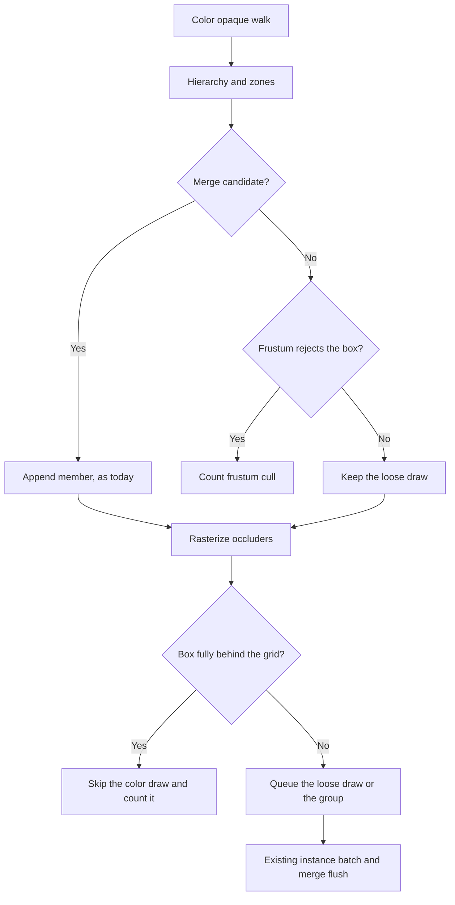
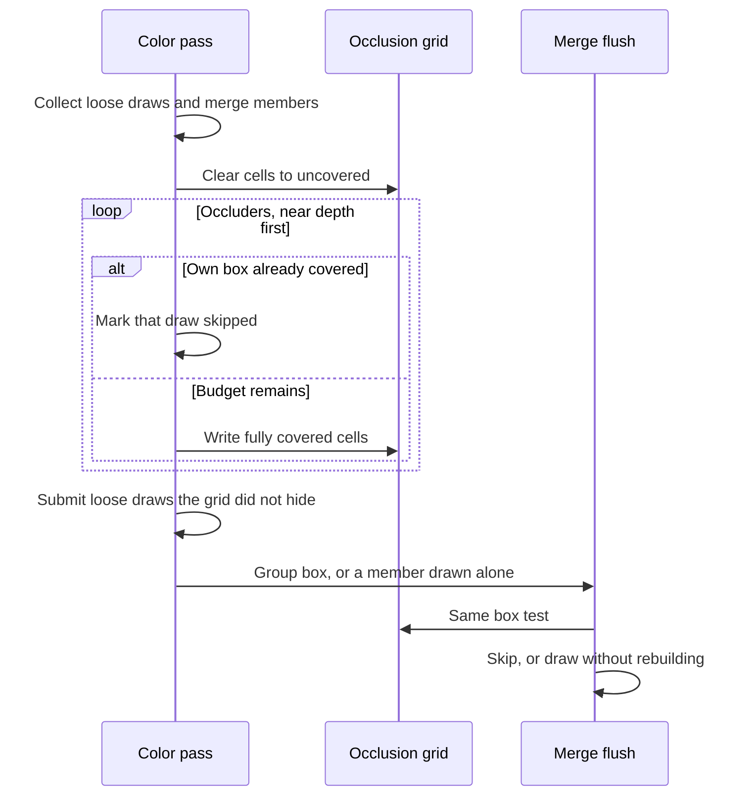

# Occlusion Culling — Developer Guide

Implementation guide for skipping color-pass draws whose boxes sit fully behind this frame's opaque triangles. Assumes the opaque walk, frustum planes, visibility zones, baked mesh triangles, static mesh merging, and the editor stats panel.

## Implementation Overview





Shadow invocations of the opaque walk are absent from both diagrams. They never clear or read the grid.

## Glossary

| Term | Implementation meaning |
|------|------------------------|
| Grid | 90 rows. Column count is the camera aspect times 90, at least 1 and at most 256. Resized only when that pair changes |
| Depth | `clip.z / clip.w` after multiplying the color view-projection. 0 on the near plane, 1 on the far plane, nearer smaller |
| Cell write | The three vertices all project in front of the near plane, and all four corners of the cell lie inside the triangle. The cell stores the minimum of its current depth and the farthest of those three vertices |
| Screen fraction | Area of the box's normalized-device rectangle divided by 4. A box that does not fully project counts as large enough to try |
| Budget | At most 2,000 triangles submitted to the rasterizer per color pass, after the front-to-back sort |
| Skip key | The loose draw, the merged group, or the member that flush would have drawn on its own |
| Active grid | A begun grid returns real answers. An unbegun grid, including every shadow pass, answers "not hidden" |

## Step-by-Step Requirements

### 1. Keep the grid off the renderer abstraction

Add one CPU type next to the frustum. It owns the float cells and the triangle counter. `SceneRenderPipeline` holds one instance and reuses it, the same way it reuses the active zone-id list. `SceneRenderPipeline` is already a large static class; the raster math does not go in that file.

No DryIoc registration. No component. No serializer. No new system. The work runs inside the color call that `SceneRenderSystem` (priority 150) and the editor viewport already make.

### 2. Use this engine's depth, and only on x and y use the window map

LearnOpenGL's depth chapter stores window depth in `[0, 1]`, nearer smaller, with `GL_LESS` meaning a fragment passes when its depth is less than the stored depth. This engine's perspective (`CreatePerspectiveFieldOfView`) and the hand-written light ortho already place the near plane at clip z = 0 and the far plane at clip z = 1. The grid stores `clip.z / clip.w` and does not apply the extra `* 0.5 + 0.5` that classic OpenGL uses when normalized-device z spans `[-1, 1]`. Applying that remap would disagree with the frustum, whose near plane is clip z ≥ 0.

Horizontal and vertical cell edges do use the usual map from normalized device coordinates in `[-1, 1]` onto the grid. Row 0 is normalized-device y = −1, the bottom, matching `gl_FragCoord`.

The color pass still depth-tests the draws it actually submits, on the existing full-resolution buffer. The grid does not read or write that buffer. Hardware occlusion queries (`GL_SAMPLES_PASSED`, `GL_ANY_SAMPLES_PASSED`, and `glGetQueryObject` as documented on the Khronos query-object page) are the GPU mechanism for this problem. They stay unused: a result read in the same frame stalls the single render thread, and a result from an earlier frame drops a mesh that became visible only now. LearnOpenGL's query-object chapter was not available (the URL returned 404); the depth chapter is the reference the grid follows for range and comparison direction.

Two deliberate differences from a GPU depth buffer, both because a cell is much larger than a sample:

- A GPU buffer using `GL_LESS` stores the nearest passing sample. A cell stores the farthest vertex of a triangle that covers the whole cell, then keeps the nearer of those values when another triangle also covers it. Storing the nearest vertex would hide a mesh that sits in front of the far part of that coarse cell.
- A GPU sample is covered when its center lies in the triangle. A cell is covered only when all four corners do. A sliver that would light a sample leaves the cell uncovered.

### 3. Split the color walk from the shadow walk

The color call passes a flag the shadow calls leave off. With the flag off, the walk stays as it is today.

With the flag on, the walk still applies hierarchy and visibility zones. Merge candidates are still appended with no frustum test on the member. Loose cubes and submeshes that the frustum rejects are counted and dropped. Loose survivors are stored in a reused list and are not submitted yet.

After that walk, begin the grid from the color view-projection. If the matrix cannot produce a positive finite aspect (`M22 / M11`), leave the grid unbegun and submit every survivor. That is the safe failure for a broken camera.

### 4. Choose occluders and write the grid

An occluder is a survivor that has CPU triangles, has alpha cutout off, and whose screen fraction is at least 0.02. Loose cubes use the existing cube template (the same ±0.5 positions as the unit-cube box). Loose submeshes and merge members use baked positions and indices, transformed by that member's draw matrix. A merged group is one candidate when its group box survived the frustum: its screen fraction is the group box, and its triangles are the solid members' baked triangles. Cutout members add no triangles. A mesh with no baked triangles is not an occluder; if it has a box it can still be hidden.

Sort those candidates by nearest corner depth, closest first. A candidate whose corners do not all sit in front of the near plane sorts as nearest, so any of its triangles that are fully in front are written before farther occluders are judged.

For each candidate, while the budget remains:

- If its box is already fully behind the grid, do not rasterize it. The later box test still skips the draw.
- Otherwise submit its triangles until 2,000 have been submitted. Stop the rest of the list when the budget is spent. Triangles past the budget, and triangles that meet the near plane, simply are not written. Both cases hide fewer objects.

### 5. Skip draws only after the grid is finished

Submit each loose survivor whose box is not fully behind the grid, through the same cube draw and instance queue as today. A hidden loose mesh never enters the batch.

At merge flush, which already frustum-tests the group box and any member it draws alone, ask the grid the same question. A hidden group is not drawn and is not rebuilt. A group whose box still sticks out is drawn as a whole. A member that flush draws alone, because the group has a single member or because a lamp sits inside the group box, takes the same box test before its own draw.

The grid is then unbegun, so a later shadow pass cannot see this camera's cells.

### 6. Count color rejects separately

Add an occlusion count on the color pass stats and copy it to the frame statistics beside the frustum count. The editor stats panel and the benchmark copy that already print frustum culls print this count too. Shadow stats do not include it.

## Raster and box test

Project a world point with the color view-projection. Reject the point when `w` is not finite and greater than `1e-8`, or when any component of the result is non-finite. Depth is `z / w`. The cell coordinate is `((x / w) * 0.5 + 0.5) * columns` and the same for `y` and rows.

```
write triangle:
    project the three vertices, or leave the grid unchanged
    if any depth is negative: leave the grid unchanged
    far = max(depth0, depth1, depth2)
    for each cell whose four corners are inside the triangle:
        cell = min(cell, far)

box is hidden:
    project all eight corners, or return not hidden
    if any depth is negative: return not hidden
    near = min of the eight depths
    rect = cells overlapped by the eight projected points
    if the rect is empty: return not hidden
    hidden only when every cell in the rect is finite
        and near > cell + 1e-5
```

A cell starts at positive infinity, which is the uncovered sentinel. The `1e-5` gap keeps a box that merely touches a stored depth on screen. Four-corner coverage uses the cell's rectangle in normalized-device space, so a wide frame that hit the 256-column cap still cannot mark a cell from a triangle that misses a corner.
