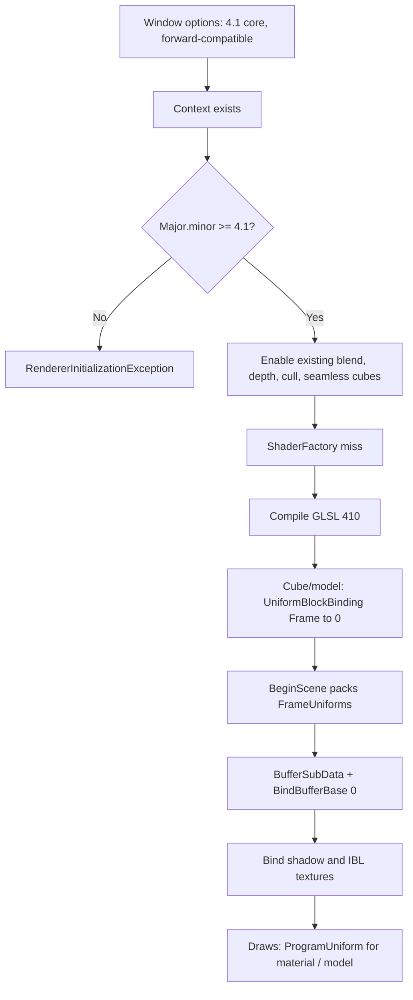
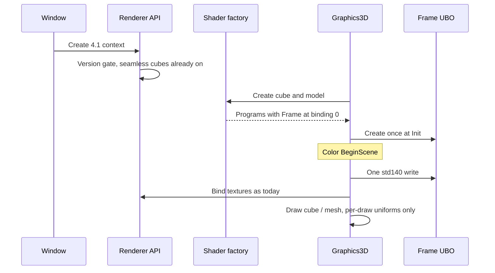

# OpenGL 4.1 — Developer Guide

How to raise the context, retarget shaders, and add the frame uniform buffer. Assumes the current `IRendererAPI` boundary, `ShaderFactory`, and `Graphics3D.BeginScene`.

## Implementation Overview

## Glossary

| Term | Implementation meaning |
|------|------------------------|
| Binding 0 | `glBindBufferBase(UNIFORM_BUFFER, 0, …)` plus `glUniformBlockBinding` on cube and model. Not a GLSL `layout(binding = 0)` qualifier |
| FrameUniforms | One unmanaged struct whose field order and padding match the GLSL `Frame` block |
| Point shadow mask | Eight enable flags packed into one int bit per light. Avoids an std140 `int[8]` (16 bytes per element) |
| Include loop | Splice every `#include "name"` in the file, repeat until none remain. Today only the first include is expanded |

## Step-by-Step Requirements

### 1. Request 4.1 at every window

Set the Silk.NET graphics API on editor, Runtime, and headless test windows to OpenGL, core profile, forward-compatible, version 4.1. Do not leave `WindowOptions.Default`’s 3.3 request in place on any of those three paths.

### 2. Gate the version in renderer init

After the context is current, read major and minor. If the pair is below 4.1, throw `RendererInitializationException` naming the version found. Keep the existing blend, depth, cull, and `TEXTURE_CUBE_MAP_SEAMLESS` enables. Seamless cubes are already on; do not add per-texture seamless flags.

### 3. Retarget every GLSL file

Every `.vert`, `.frag`, and `.glsl` under `assets/shaders/OpenGL` starts with `#version 410 core`. Remove the gpu_shader5 extension and its comment from cube and model fragments. Do not add `layout(binding = …)` on uniform blocks or samplers.

Add `frame.glsl` with the std140 `Frame` block using the current `u_*` names so vertex shaders and `shadow.glsl` keep the same identifiers. Cube and model vertex and fragment files include it. `shadow.glsl` drops the uniform lines that moved into the block and keeps `sampler2DShadow u_ShadowMap`.

Expand includes in a loop so a file may include `frame.glsl` and `shadow.glsl`. Nested includes are not required beyond that.

### 4. Pack the frame block to std140

Matrices occupy 64 bytes each and are stored in the byte order that today’s `UniformMatrix4(..., transpose=true)` already sends, so `vec4 * mat4` in the shaders does not change. `vec3` values ride in `vec4` slots. Point positions, colors, and intensity+range are three arrays of eight `vec4`. Then packed scalars: light count, shadow enable, cascade count, PCF taps, cascade split, map sizes, point PCF, point-shadow bitmask, IBL flag. Pad the struct to a multiple of 16.

Samplers stay as `SetInt` at `Graphics3D.Init` on the same units as today (shadow 3, point cubes 4–11, occlusion 12, IBL 13–15).

2D, depth, sky, bake, and post programs do not declare `Frame`. The emissive program shares `modelShader.vert`, so it binds and reads the same `Frame` block as the lit model pass; `DrawEmissive` only sets material uniforms such as `u_Emissive`.

### 5. Write the UBO once per color BeginScene

Create the buffer at `Graphics3D.Init` with `IRendererAPI.CreateUniformBuffer`. `BeginScene` fills `FrameUniforms` from the fields `UploadFrame` already reads, uploads once, binds to point 0, then binds textures. Delete the per-shader `UploadFrame` uniform walk. `DrawCube` / `DrawMesh` must not write view, lights, or shadow knobs.

Cheap win: two programs × ~30 uniforms become one `BufferSubData`. Texture binds stay once per `BeginScene`, unchanged.

### 6. ProgramUniform on IShader

Every `IShader.Set*` calls `glProgramUniform*` with the program id. Remove the `UseProgram` that currently wraps each setter. `Bind` / `Unbind` remain for draws. Missing uniforms still no-op.

After link, if the program has a uniform block named `Frame`, set its binding to 0.

### 7. Tests and docs that still say 3.3

Unit: `FrameUniforms` byte size equals the GLSL block size; `BeginScene` updates the UBO mock once and a cube draw does not set view/lights. Graphics: init reports 4.1 or higher; every shader in the OpenGL tree still links. Add a test that every shader file’s first non-empty line is `#version 410 core`.

Update `docs/architecture/README.md`, the user guide GPU line, and the README requirement from “3.3+” to “4.1+” in the same change. Do not rewrite old specs’ GLSL snippets.

## OpenGL practice

Matches LearnOpenGL Advanced GLSL for std140 blocks, `glUniformBlockBinding`, and `glBindBufferBase`. Matches 4.1 program uniforms. Divergences that stay: row-vector multiply (`vec4 * mat4`) with CPU transpose, already used everywhere; global seamless cubes instead of 4.0 per-texture flags, already in `Init`.
