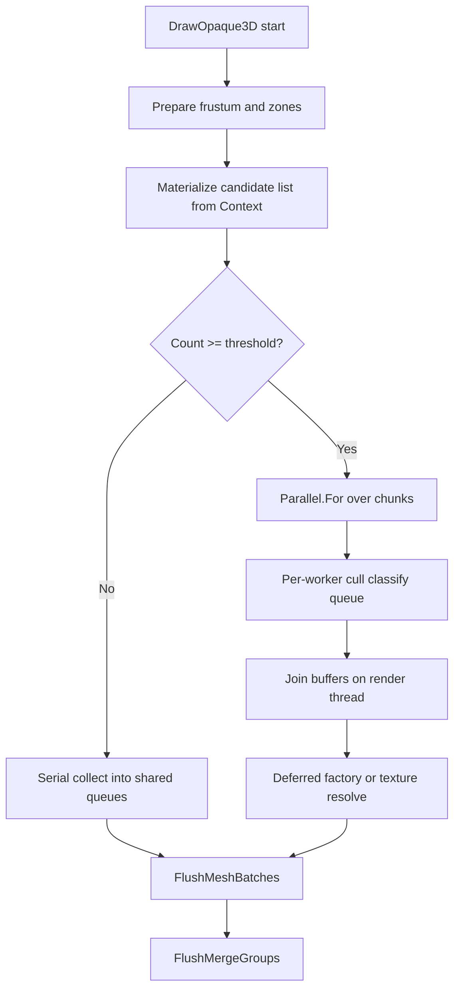
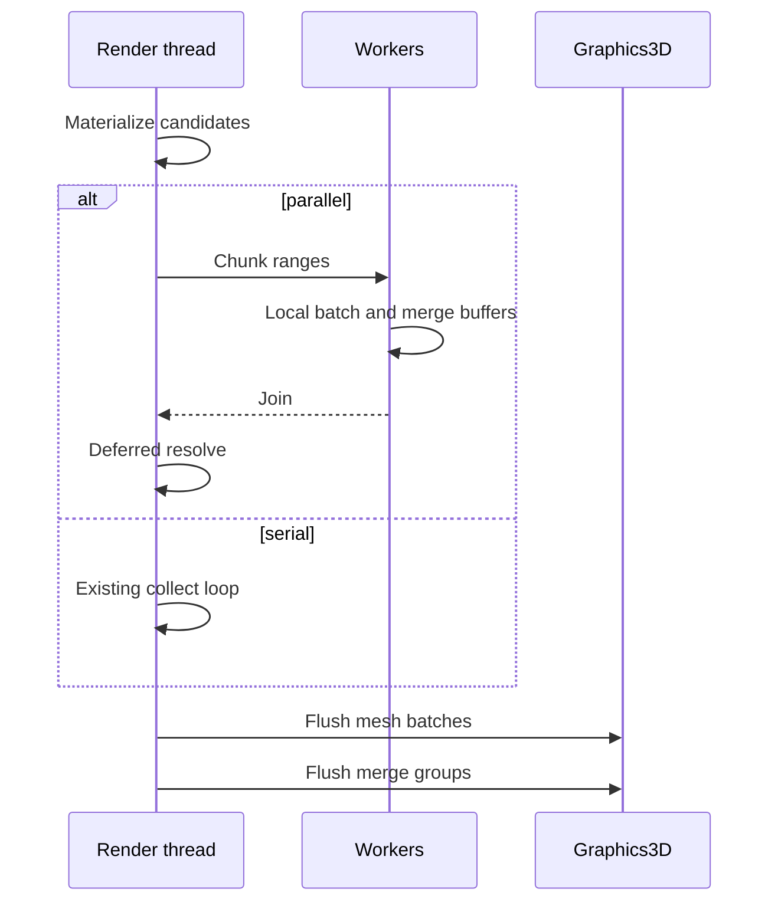

# Parallel Opaque Collect — Developer Guide

How to land chunked parallel collect inside the existing opaque 3D walk without a job system and without moving OpenGL off the render thread.

## Implementation Overview





## Glossary

| Term | Implementation meaning |
|------|------------------------|
| Candidate | Struct: entity id, world draw matrix, model-renderer fields needed for resolve/cull/queue (path, mesh index, tint, PBR, LOD bias, zone id, pivot, tiling, texture path, merge flags as required) |
| Worker buffer | Thread-local dictionary of mesh batch keys → instance lists, plus merge member lists keyed like today’s merge path |
| Chunk | Contiguous index range into the candidate array given to one `Parallel.For` iteration |
| Stats wall time | `CollectCpuMs` measures prepare + collect + join (+ deferred), not per-worker CPU sum |
| Force serial | Debug or test switch that always takes the below-threshold path |

## Step-by-Step Requirements

### 1. Keep flush where it is; only parallelize the walk body

Today `DrawOpaque3D` times collect, then `FlushMeshBatches`, then `FlushMergeGroups`. Leave that outer shape. Extract the entity loop into a collect routine that can target either the shared queues (serial) or a worker buffer (parallel). Flush always runs on the caller thread after join.

Why: Mesh/merge flush is ~1 ms and owns GL. Parallelizing it has no payoff and breaks the single-context rule.

### 2. Materialize before any worker runs

On the render thread, iterate `View<ModelRendererComponent, TransformComponent>` once. Apply only what must stay tied to live entities if needed for hierarchy visibility; prefer copying `EffectiveVisible` / world matrix / component field values into the candidate array so workers never call back into `Context`.

Why: ECS storage is not a concurrent reader under mutation. After materialize, the pass owns a stable array.

```
clear candidate list (reuse capacity)
for each opaque renderer pair:
    append candidate
if count < threshold or force serial:
    serial collect into shared MeshBatches / merge state
else:
    parallel collect
deferred resolve on render thread
flush mesh batches
flush merge groups
```

### 3. Workers: cull and queue only; no factory Create on miss

For each candidate in the chunk: visibility zone check (using the zone set prepared on the render thread), resolve opaque surface from **already cached** model data, frustum / caster tests, LOD, merge classify, append to the worker’s batch or merge lists. Cubes that the serial path would `DrawCube` immediately (non-merge) append to a worker **immediate-cube** list; after join the render thread replays those draws before or within flush, in a stable order (e.g. ascending entity id). Merge-classified cubes still go to merge member lists only. Serial and parallel must produce the same set of cube draws and merge members.

If the model or texture is not safely readable from cache: push a deferred-resolve record (candidate index + reason). Do not call model or texture create from a worker.

Why: First load uploads GPU resources; that must stay on the render thread.

### 4. Join without locking the hot loop

After `Parallel.For` completes, on the render thread: for each worker buffer, merge instances into the shared `MeshBatches` (or flush worker buffers sequentially into graphics only after a single merged structure — prefer one merge into today’s structures so `FlushMeshBatches` stays unchanged). Same for merge members. Aggregate cull / draw counters into `PassStats`.

Warned-model / warned-sprite sets are updated only on the render thread during deferred resolve or serial collect.

Why: Lock-free collect needs thread-local writes; one merge keeps the existing flush code.

### 5. Threshold, fallback, and reuse

- Choose a threshold high enough that IslandDash goes parallel and empty editor scenes do not.
- On any worker exception: log, abandon partial worker buffers, run serial collect for that pass.
- Reuse the candidate list and a small pool of worker buffers across passes in the same frame (color + shadow) and across frames: `Clear` lists, do not allocate new maps every pass.

Why: Scheduling and allocation overhead otherwise eats the win on small views; reuse protects the hot path.

### 6. Call sites

Every `DrawOpaque3D` invocation (directional shadow, point-shadow faces, color) uses the same collect/flush split. Pass-specific parameters (cull matrix, caster max distance, skip-casters-containing-light, LOD view) are captured in a readonly collect context passed into chunks.

Why: One implementation; shadow collect is the second measured consumer.

### 7. Editor and Runtime

No new DryIoc service. Editor viewport and Runtime both enter through `SceneRenderPipeline.RenderScene`. Optional force-serial for debugging may hang off existing renderer stats or a debug setting; it is not required for MVP correctness.

### 8. Cheap wins to keep

- Reused candidate and worker buffers (no per-frame dictionary churn).
- Threshold gate.
- No `ConcurrentDictionary` in the cull loop.

Do not add color‖shadow overlapping collects or a custom thread pool in this feature.

### 9. OpenGL boundary

Workers never touch `IGraphics3D`, `IRendererAPI`, or buffer factories. LearnOpenGL-style single-context use stays intact: all binds and draws happen in flush on the render thread after CPU join.

## Testing Focus

| Check | Expectation |
|-------|-------------|
| Serial vs parallel equivalence | Same batch key multiset, instance counts, cull counters above threshold |
| Below threshold | No parallel scheduler use; results match today’s walk |
| Deferred miss | Fake factory: zero Create from worker threads; main thread Create once |
| Worker throw | Serial fallback; pass completes |
| Shadow params | Caster-distance / lamp-inside cull counts match serial |
| Flush gating | Graphics fake: zero draws during collect, draws only in flush |

IslandDash benchmark validates success metrics (CollectCpuMs and frame ms); it is not a substitute for the equivalence tests above.
