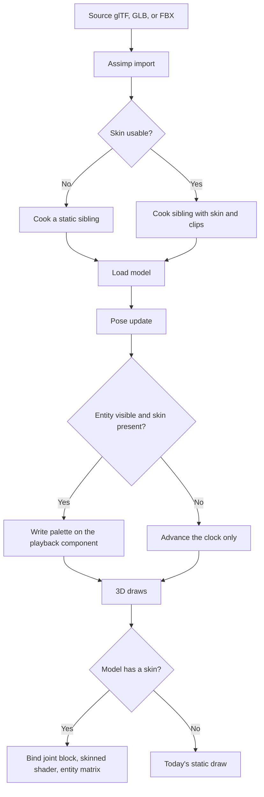
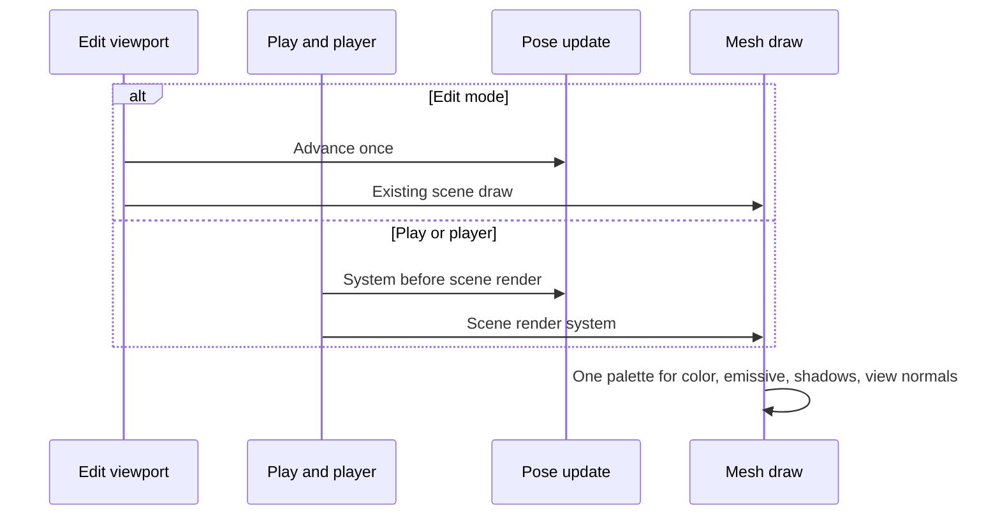

# Skeletal Animation — Developer Guide

Implementation guide for playing one named clip on a skinned mesh. Assumes the cooked model sibling, the opaque mesh draw, and the row-vector matrix order already used by node transforms (`local * parent`).

## Implementation Overview





## Glossary

| Term | Implementation meaning |
|------|------------------------|
| Sibling version 2 | Cooked file whose header is 144 bytes and whose version field is 2. Version 1 is rejected |
| Pose update | The shared function the edit viewport and the priority-145 system both call |
| Rest palette | Joint matrices built once at load from rest locals. Used when no clip palette is ready |
| Joint block | One uniform buffer, binding point 0, std140, 128 matrices of 64 bytes. Filled with each matrix transposed |
| Key cursor | Last key index used for one joint channel. Cleared when the clock moves backward |
| Weight record | Four joint indices and four weights stored after that submesh's indices. Absent on a static submesh |
| Skinned submission | One non-instanced draw. Locations 0–5 match a static mesh. Location 6 is the joint indices. Location 7 is the weights |

## Step-by-Step Requirements

### 1. Cook skin and clips into the sibling

The player never parses the source, so anything the shader needs has to be in the sibling. Bump the format version to 2 and the importer revision to 8, and add Assimp's limit-bone-weights step with a maximum of 4. The revision change makes an old sibling look stale, which is what already triggers a cook in the editor.

Keep the existing vertex stride for positions, normals, texture coordinates, tangents, and bitangents. When the file has a skin, every submesh stores one weight record per vertex. A vertex with no influences stores zeros. Put the skeleton and the clips in two tables addressed from the last 16 bytes of the 144-byte header. An empty skin table means a static model.

On each joint, store the parent index, the inverse bind after the same row-fix the node matrices already use, and the rest translation, rotation, and scale. Read Assimp quaternions field by field into x, y, z, w. A memory copy swaps w and x.

Drop the skin, and write the meshes without weights, when any of these are true: more than 128 joints, a parent cycle, a parent index past the list, a non-finite inverse bind, or a rest matrix that does not decompose into translation, rotation, and scale. Log that the skin was dropped. The mesh vertices still cook.

Keep the first clip when two clips share a name. Skip a channel whose joint is unknown or whose key is non-finite. Duration is the latest key time. A clip with no usable keys has duration 0. A second skin is ignored. Its primitives are ordinary submeshes.

A sibling whose tables fail a count, range, or finiteness check is rejected whole. No vertex buffer is allocated, and the opaque walk draws the stand-in cube used for any model that fails to load. The editor cooks from the source when the sibling is missing or the stamp disagrees, which is how a version-1 file gets replaced. A version-2 file with a matching stamp and bad tables stays on disk.

### 2. Advance the clock and write one palette

Sampling has to finish before any 3D pass, and edit mode does not run systems. One function takes the entity registry, the model factory, and the frame delta. The system at priority 145 calls it during play and in the player. The edit viewport calls it and then draws. Play mode takes the system branch only, so the clock moves once.

```
for each playback component:
    if the model has no skin: mark the palette unready and continue
    if the clip name is empty, unknown, or duration is 0:
        time = 0
        mark unready
        continue
    previous = time
    time += frame seconds
    if looping: wrap into the duration
    else: clamp to the duration
    if time < previous: clear key cursors
    if the entity is not effectively visible:
        mark unready
        continue
    for each joint:
        local = scale * rotation * translation
        missing channel uses the rest value
        step holds the latest key at or before time
        linear blends translation and scale, and slerps rotation
        before the first key, use the first key
        after the last key, use the last key
    global(root) = local
    global(child) = local * global(parent)
    palette = inverseBind * global
    write the palette into the existing array
```

Allocate the palette, the local-matrix scratch, and the cursors when the joint count changes. Rewrite them in place on later frames. The model factory's path cache supplies the skin, so this walk does not parse the source. Search keys forward from the cursor. Clear the cursors on the frame the clock moves backward, including a frame where the entity is hidden, so a loop that wraps off screen does not resume from the last key. A hidden entity still advances its clock, so a play-once clip can finish off screen. The next visible frame rebuilds the palette before the draw.

A different clip name sets the clock to 0 and clears the cursors. The same name leaves the clock alone. A non-finite clock becomes 0. The frame delta is the render delta, not the fixed physics step.

Scripts in this repo use priorities 100 through 140. A script at 145 or later changes the clip one frame after it writes the name.

### 3. Draw with that palette

The draw coordinator is already large. It should branch on the submesh and bind a palette. It should not sample keys.

A model with no skin keeps today's path: pivot, instancing, unpack, and the static shaders.

A model with a skin is one entity. Ignore the pivot. Every submesh uses the entity world matrix, the joint block, and the skinned shader, and stays out of the instance batch. If the playback palette is unready or the joint count disagrees with the model, bind the rest palette computed at load.

Upload the used joint range only. Transpose each matrix as it is written, the same way instanced model matrices are stored, so the shader can keep multiplying `position` on the left. Binding point 0. The platform backend owns the buffer object. One buffer is reused for the frame.

The skinned vertex shader runs anywhere a mesh vertex is transformed: the color program, the emissive pass that shares the model vertex stage, directional depth, point depth, and the view-normal model program. Fragment shaders stay as they are. A vertex whose weights sum to zero uses an identity skin matrix so it stays on the stored position.

LearnOpenGL's skeletal article uses a uniform array of 100 matrices and multiplies the matrix on the left. A uniform array of that size does not fit OpenGL 3.3's 1024 vertex-uniform components once this shader's view and model matrices are counted. The uniform-buffer chapter is the practice that fits: std140, one binding point, 64 bytes per matrix. Shader storage buffers require OpenGL 4.3. Normals and tangents use the upper 3×3 of the skin matrix, as that article does. A joint with non-uniform scale can tilt a normal. The model shader still rebuilds the bitangent with the cross product.

The cull box stays the stored mesh bounds in entity space. A limb outside that box can be culled while the entity's origin is still on screen.

### 4. Spawn and inspect without unpacking

Unpacking a skinned file would parent the pieces at the bind pose and then skin them again. When the model has a skin, hierarchy import leaves every submesh on the root, leaves the root transform where the user put it, and sets the pivot to zero. Lights in that file are parented to the root with their transform from the file root.

Add the playback component if the root does not have one. Leave an existing clip name and loop flag alone so a reimport does not reset the selection. The default loop flag is on, so a clip chosen in the inspector keeps cycling in the edit preview.

The component editor lists the clip names on the loaded model and an empty row for the rest pose, plus the loop checkbox. It lives in the editor project. The player never references it. Clips are not separate files. The content browser's animations folder is unused.

The scene serializer writes the clip name and the loop flag with the other built-in components. The clock, the palette, and the cursors stay out of the file. Copying an entity copies the name and the loop flag, starts the clock at 0, and allocates a new palette array.

### 5. Prove the pose on the CPU

The multiply is the failure that matters, and it does not need a window. A two-joint chain in the rest pose must produce an identity palette. Build the chain in the test. Do not load a golden file.
