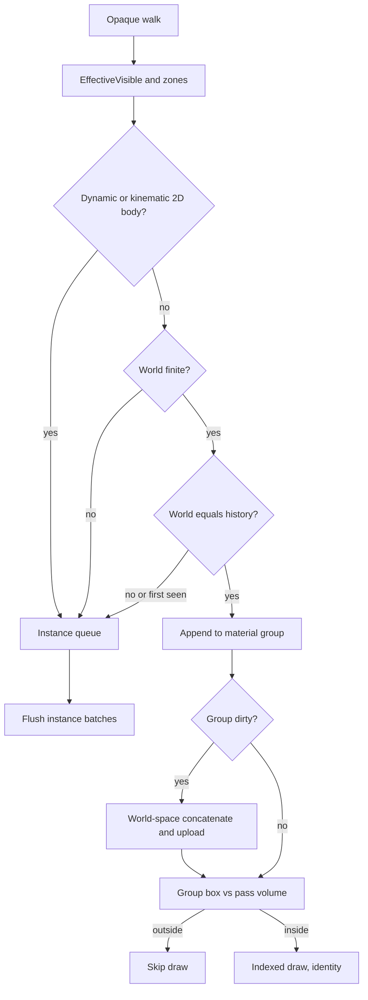
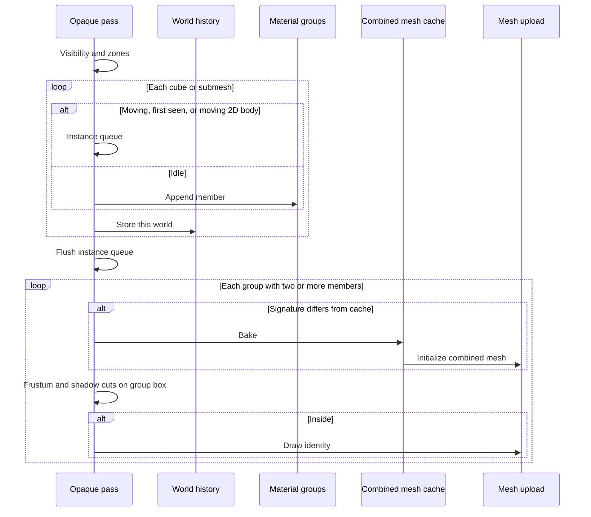

# Static Mesh Merging — Developer Guide

Assumes the opaque walk, instance flush, mesh upload, frustum planes, visibility zones, and 2D rigid-body types.

## Implementation Overview

## Glossary

| Term | Implementation meaning |
|------|------------------------|
| History | Dictionary of entity id to last world matrix, cleared on scene unload |
| Material key | Textures by object identity, tint, three PBR factors, emissive, cutout, double-sided |
| Member signature | Entity ids, source mesh identities, and worlds in a group, hashed for dirty |
| Bake snapshot | CPU positions, normals, tangents, bitangents, uvs, and indices kept on the source mesh after GPU upload |
| Group box | Union of each member's local box transformed by that member's draw world |
| Vertex cap | Same 256 MB vertex-buffer budget used by instancing; split into another combined mesh rather than drop members |
| Rebuild count | Times a combined mesh was uploaded this pass; logged with existing 3D stats |

## Step-by-Step Requirements

### 1. Keep a bake snapshot on the source mesh

Upload still builds the VAO and still records the local box. It must not be the last time the CPU sees the vertices. Store a snapshot (or skip clearing the lists) so a later concatenate can read them. A mesh with no snapshot is ineligible for a group and stays on the instance path. Unit cubes that have no imported mesh use the same unit box the cube draw already uses, generated at bake time.

Without this step every imported mesh is ineligible after the first `Initialize`, and the feature does nothing.

### 2. Classify after visibility, before instance queue

Skip suppressed draws, bad mesh indexes, invisible subtrees, and zone rejects as today. Then:

- Dynamic or kinematic `RigidBody2D` → instance queue. Static 2D bodies may merge.
- Non-finite world → instance queue. Do not put that matrix in a bake.
- Missing history or world not equal to history → instance queue.
- Else append to the material group.

Write history for every visited renderer after the test, including movers, so the next still frame can enter a group.

Point-shadow faces and the directional pass use this same classification. They must not frustum the source before grouping.

### 3. Rebuild only when the group signature changes

Two or more members: compare the signature to the cached combined mesh. On mismatch, concatenate:

- Draw world is the same matrix the instance path would use, including pivot.
- Position is that matrix times the snapshot position.
- Normal, tangent, and bitangent use the inverse-transpose 3×3, then normalize.
- Entity id on each vertex is the member's entity.
- Indices are copied with the running vertex offset.

Identity is the draw transform. The combined mesh's local box is the group box in world space (min/max of baked positions).

If `Initialize` fails, log once, drop that cache entry, and queue the members as instances this pass.

If the concatenated vertex bytes would exceed the vertex-buffer cap, start another combined mesh with the same key and continue. Do not drop a member.

A group of one never bakes.

### 4. Cull the group, not the sources, at draw time

Build pass planes as frustum culling already does. Test the group box against them. Directional caster distance and “lamp inside caster” use the same box. If the group is skipped, do not draw it; do not rebuild it.

Color and shadows share the cached GPU mesh. They do not share skip decisions.

### 5. Dispose with the scene

When the active scene unloads or is replaced, dispose combined meshes, clear group cache, and clear history. Do not leak VAOs across Play/Stop in the editor.

### 6. Count it

Add merged-group draws, merged vertex count, and rebuilds to the existing once-per-second 3D stats. Do not add an editor window.

## Cheap performance win

History is in-place matrix writes. Member lists come from the same pool pattern as instance batches. A still camera over a still group is one indexed draw and no buffer write. The expensive work is the rebuild; it is gated on signature change only.

## OpenGL practice

The combined object is an ordinary indexed mesh: interleaved vertex layout already used by `Mesh`, one element buffer, `DrawElements`, static draw. World transform is applied on the CPU at rebuild, which is how mesh concatenation is described in core-profile mesh tutorials. Engine code still talks to the mesh/graphics facades, not to raw GL. Divergence: the buffer is not streamed every frame; a rebuild hitches on the single GL thread, which this engine already accepts for first-time mesh upload.
