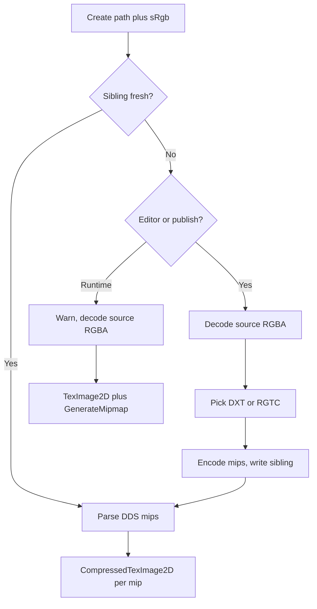
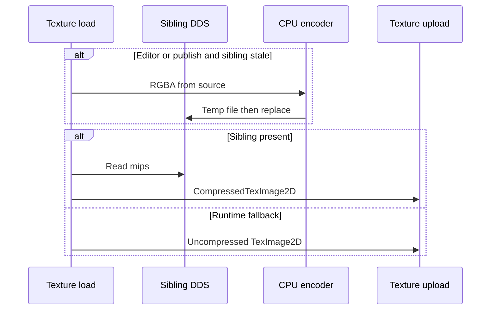

# Texture compression (BC / DXT) — Developer Guide

Guide for cooking a DDS sibling and uploading it compressed. Assumes today’s `ITextureFactory` path cache, `TextureFileDecoder`, `OpenGLTexture2D` upload, and publish copy of `assets/`.

## Implementation Overview

## Glossary

| Term | Implementation meaning |
|------|------------------------|
| Sibling path | `{source}.srgb.dds` or `{source}.linear.dds` |
| Raster source extension | `.png`, `.jpg`, `.jpeg`, `.tga` (case-insensitive) |
| Source DDS | A `.dds` the scene already points at; GPU path uploads it compressed when the FourCC is DXT or RGTC |
| Format pick | `sRgb` true plus any `a < 255` → DXT5 sRGB; `sRgb` true opaque → DXT1 sRGB; linear occlusion map → BC4; linear normal map → BC5; other linear → DXT5 |
| Normal map | The load that already passes `sRgb: false` for the model normal path (same as today’s factory call) |
| Host cook flag | True in the editor host and in publish. False in the Runtime player |

## Step-by-Step Requirements

### 1. Keep decode for preview, split the GPU path

`Decode` and `DecodePreview` stay on the source file and return packed RGBA. They may still decompress a DDS with Pfim. GPU `Create` must not use that decompressed buffer when a BC sibling (or a BC source DDS) is available.

Why: ImGui previews need 8-bit color. The GPU path must not pay Pfim decompress for a format the driver can sample.

### 2. Pick the format from `sRgb` and channel use

| Load | GPU format | OpenGL internal format |
|------|------------|------------------------|
| Albedo / sprite / emissive, opaque | DXT1 sRGB | `COMPRESSED_SRGB_S3TC_DXT1_EXT` |
| Same, any alpha below 255 | DXT5 sRGB | `COMPRESSED_SRGB_ALPHA_S3TC_DXT5_EXT` |
| Metallic-roughness | DXT5 linear | `COMPRESSED_RGBA_S3TC_DXT5_EXT` |
| AO, one channel | BC4 | `COMPRESSED_RED_RGTC1` |
| Normal | BC5 | `COMPRESSED_RG_RGTC2` |

Metallic stays in blue and roughness in green, so metallic-roughness cannot use BC5.

Why: S3TC is the color format OpenGL 3.3 can use on Windows and on macOS when the S3TC extension is present. RGTC is core. BC7 is not.

### 3. Encode mips and write a DDS

If either source dimension is not a multiple of four, keep the raster so OpenGL repeats at the source dimensions. Legacy padded sidecars are bypassed when loading a raster. Encode a full mip chain down to 1×1 (block formats still write a 4×4 block at the bottom). Write a DDS that records GPU width/height, source width/height, mip count, FourCC / DX10 format, and raw mip bytes.

Write to a temporary file in the source directory, then move it into place. An existing sibling requires engine metadata before replacement.

Why: `CompressedTexImage2D` requires a correct `imageSize` (blocks × 8 or 16 bytes). `GenerateMipmap` on a compressed texture is not reliable; LearnOpenGL and the OpenGL wiki expect stored mips or uncompressed generate.

### 4. Upload on the render thread

For each mip: bind `TEXTURE_2D`, `CompressedTexImage2D` with the sibling’s internal format, `imageSize`, and pointer. Min filter `LINEAR_MIPMAP_LINEAR` when mip count > 1, else `LINEAR`. Mag `LINEAR`. Wrap `REPEAT`. Keep the existing anisotropy parameter. Do not call `GenerateMipmap`.

Query S3TC once per context. If it is missing, skip DXT cook and DXT upload; RGTC may still upload. Runtime then uses the RGBA fallback for color maps.

Why: Compressed upload is the same object lifetime as today’s `TexImage2D` (gen, bind, fill, parameter, no extra FBO). Engine core still does not call GL.

### 5. Reconstruct Z from BC5 normals

The model fragment shader currently expands `texture(u_NormalMap).rgb`. After BC5, only RG are valid. Reconstruct `z = sqrt(max(1 - x*x - y*y, 0))` in tangent space after unpacking XY to −1..1.

Why: BC5 is the cheap two-channel format; the third channel of a unit normal is determined by XY.

### 6. Ensure DDS siblings in the editor on `Create`, and in publish before copy

Sibling paths: `{source}.srgb.dds` and `{source}.linear.dds` (metadata stores `sRgb` / normal role).

Editor `Create`: when `EnsureTextureDdsSiblingOnLoad` is on and the matching sibling is missing, stale, or import flags disagree, encode then upload. Runtime: never write; missing sibling → warning and RGBA.

Publish: before `CopyAssets`, call `TextureBcSidecar.TryEnsureUpToDate` on raster sources. Publish infers `sRgb` from file name tokens (`normal`, `orm`, `metallic`, …). One failed encode fails publish.

Why: The player’s `assets/` copy must already contain siblings. The copy step stays a tree copy.

### 7. Cheap win

Do not decompress BC for GPU upload. Do not generate 4K mips on the GPU when the sibling has them. After the first editor cook, the viewport samples BC like Runtime.

## Error cases

| Case | Behaviour |
|------|-----------|
| No S3TC | No DXT sibling; RGBA color upload; RGTC still allowed |
| Corrupt DDS | Warning; RGBA from source; do not overwrite sibling in Runtime |
| Encode throws in editor | Keep previous sibling; this load RGBA |
| Encode throws in publish | `PublishResult.Failed` |
| Non-multiple of 4 | Use the original raster to preserve repeat sampling |
| `rock.png` and `rock.jpg` | Separate siblings (`rock.png.srgb.dds` vs `rock.jpg.srgb.dds`) |

## OpenGL check

Matches compressed texture upload in the OpenGL wiki and the same `glCompressedTexImage2D` contract LearnOpenGL’s texture chapter uses for `internalformat` / `glTexImage2D` (swap the uncompressed call for the compressed one, pass `imageSize` instead of a pixel format). Divergence: S3TC is an extension, not core 3.3; the backend must query it. `TexStorage2D` is 4.2 and is not used.
